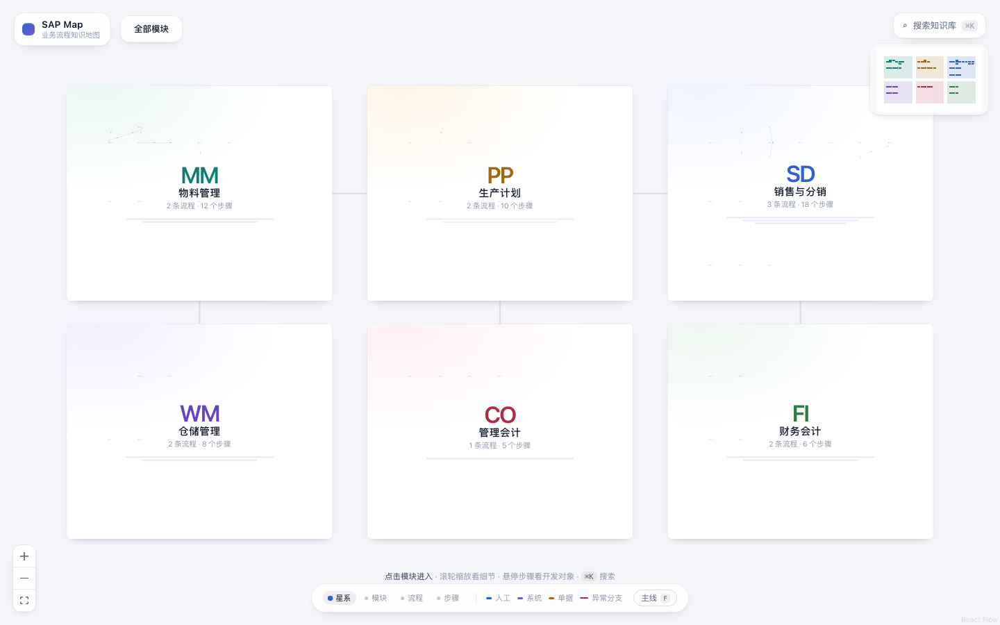
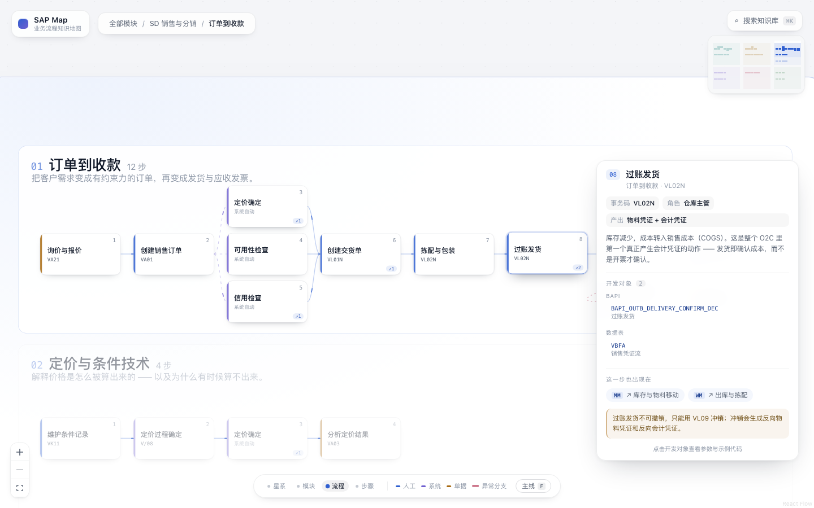
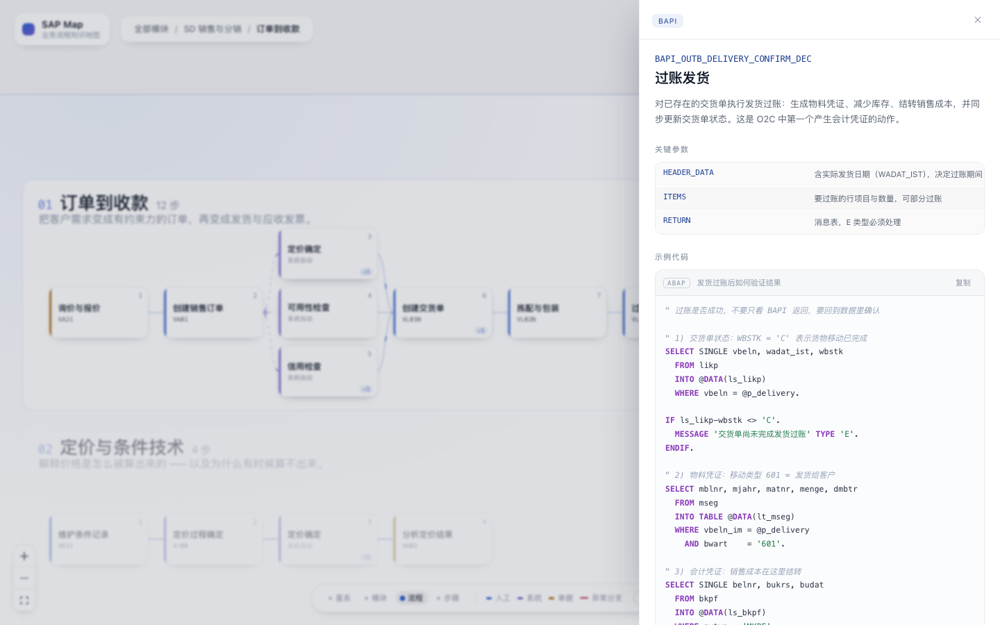
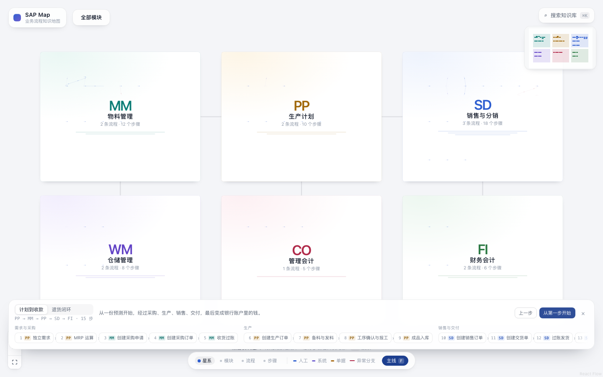
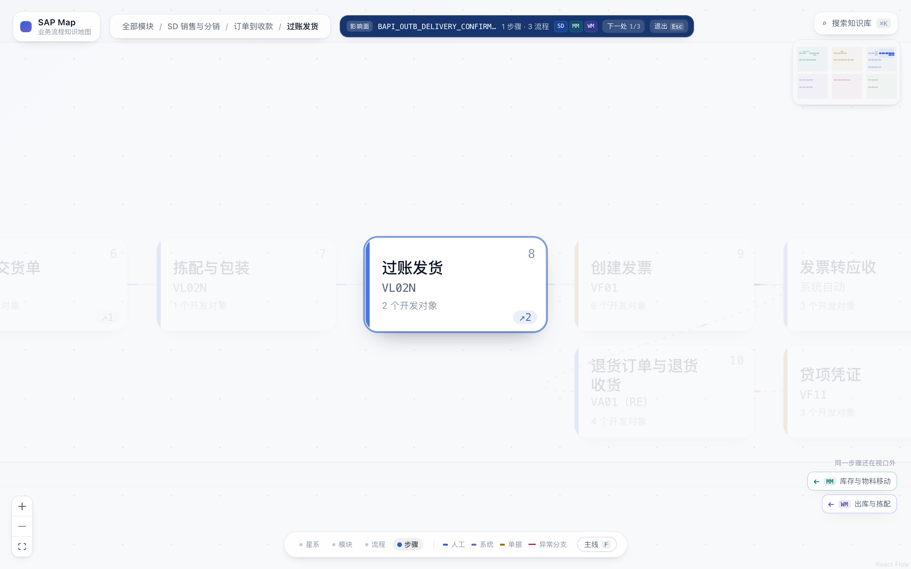
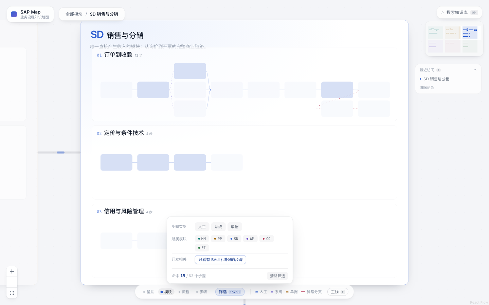

# SAP Map · 业务流程知识地图

把 SAP 看成一张**可缩放的地图**：模块 → 业务流程 → 步骤 → 开发对象。
缩放不是"放大字体"，而是换一层表达：从六个模块岛，一路下钻到某一步的 BAPI 参数和示例代码。



---

## 它解决什么问题

SAP 的知识通常散在三处：顾问脑子里的流程、SAP Help 里的对象说明、代码库里的实现。新人要串起来，只能靠人带。

这个项目把它们放在同一张画布上，并且**同一步骤只写一份**：

| | 你能看到 | 点一下 |
|---|---|---|
| L0 星系 | 6 个模块岛 + 模块间主干道 | 进模块 |
| L1 模块 | 该模块的几条流程泳道，步骤压成色条 | 进流程 |
| L2 流程 | 步骤卡片：序号、名称、T-Code、`↗n` 复用标记 | 进步骤 |
| L3 步骤 | 单步放大，悬停出开发对象清单 | 打开对象抽屉：参数 / 代码 / **被哪些步骤引用** |



点开对象就是开发视角：参数、可复制的 ABAP、常见坑、官方文档入口。



## 六个不太常见的设计

**1. 步骤（Step）与流程（Process）是多对多**
`过账发货` 同时出现在 SD 订单到收款、MM 库存管理、WM 出库三条泳道里。流程只存 `stepId` 引用，内容单点维护。所以你能看到"这一步还在哪些模块出现"，而不是维护三份副本。

**2. 借用来的步骤会标出来源**
WM 的出库泳道里，四张卡片是「SD 蓝 → WM 紫 → WM 紫 → SD 蓝」，T-code 前还标着 `SD`——不用解释就能读出「SD 交过来、WM 干活、回到 SD 发货」。

**3. 幽灵锚点 + 端到端主线**
悬停任一步骤，它在其他流程里的落位会连出虚线；落在视口外的收进右下角方向标，点一下飞过去。
按 `F` 打开主线，可以把「计划 → 采购 → 生产 → 销售 → 收款」15 步一路走完（也可以点播放让它自己走），退货闭环挂在开票那一拍下面，作为分叉而不是另一条线。



**4. 影响面：从开发对象反查回流程**
抽屉里每个对象都带「被引用于」——它出现在哪些模块的哪一步。点「在图上查看影响」，画布只留引用它的步骤，其余压暗；`下一处` 可以在 SD → MM → WM 之间轮转，`Esc` 退出。



**5. 清单与画布是同一个东西的两个面**
按 `L` 打开左栏清单：63 行「流程 × 步骤」和 105 个开发对象，可搜、按模块分组。点一行，画布飞过去；画布上选中哪一步，表就滚到哪一行。按 `P` 选两点，能看到「从 MRP 需求到收款」中间经过哪 8 跳——路径上的步骤在图上保持全亮。

**6. 画布不会把你弄丢**
平移到一片空白时，底部会出现「回到 SD 销售与分销 ↑」——箭头指着内容的方向；右上角记住最近 8 次跳转；底栏可以按「人工 / 系统 / 单据」「哪个模块」「有没有挂 BAdI」筛选，命中的保持全亮、其余的压到 0.15 而不是消失（位置还在，空间记忆不塌）。触屏上第一次点按只浮出底部抽屉，下钻是抽屉里的显式按钮。



## 跑起来

```bash
npm install
npm run dev        # http://localhost:5173
npm run validate   # 内容自检：id 唯一、引用存在、主线挂载正确
npm run build      # 先校验再构建，产物在 dist/
npm run preview    # 本地预览产物
```

内容有问题时 `build` 会直接失败并列出问题，不会带着断链出包。

## 内容怎么加

`src/data` 是资产，`src/canvas` 是渲染层，两者不互相依赖。

```
src/data/
├── types.ts          实体定义（唯一事实源）
├── modules.ts        6 个模块 + 模块间主干
├── processes.ts      流程：col/row 手工布局 + 边（含 alt 异常分支）
├── steps/            sd / mm / pp / wm / co 各一个文件
├── objects/          abap-api / enhancement / data-model / integration / mm / pp / wm / co
├── snippets.ts       ABAP / HTTP 示例
├── flows.ts          端到端主线（只引用 stepId，不复制内容）
└── index.ts          汇总 + 反向索引 + 内容自检
```

加一个步骤：

```ts
// src/data/steps/mm.ts
{
  id: 'mm.p2p.goods-receipt',       // 前缀即"原属模块"
  name: '收货过账',
  kind: 'human',                    // human | system | document
  tcode: 'MIGO',
  role: '仓库收货员',
  intent: '货到后按 PO 收货：库存增加，同时生成会计凭证（借库存 / 贷 GR/IR 暂估）…',
  objectIds: ['bapi.GOODSMVT_CREATE', 'table.MSEG', 'table.MKPF'],
}
```

然后在 `processes.ts` 里用 `{ stepId, col, row }` 把它放进某条泳道。要在别的模块复用，就再放一次——同一个 `stepId`。

## 当前规模

| 模块 | 流程 | 说明 |
|---|---|---|
| MM | 采购到付款、库存与物料移动 | 请购 → 下单 → 收货 → 校验 |
| PP | 物料需求计划、生产执行 | MRP → 订单 → 发料 → 报工 → 入库 |
| SD | 订单到收款、定价、信用 | 含退货与贷项凭证的异常分支 |
| WM | 入库与上架、出库与拣配 | 转储请求 / 转储单 / 仓位库存 |
| CO | 产品成本与毛利 | 标准成本 → 差异 → 获利分析 |
| FI | 应收与收款、应付与付款 | 与 SD / MM 共用开票与发票校验 |

合计 **12 条流程 / 50 个步骤 / 105 个开发对象 / 19 段示例代码**；11 个步骤被多条流程共用，其中 8 个真正跨模块（如 `过账发货` 出现在 SD / MM / WM 三处）。

## 技术选择

- **React Flow 13**：节点是 React 组件，才能承载"要读的信息卡片"（T-Code、角色、对象徽标）。Cytoscape 是 Canvas 渲染，拼不出卡片。
- **不用力导向布局**：布局一旦抖动，用户的空间记忆就失效。所有坐标都是世界坐标常量。
- **hash 路由**：`#/p/mm.p2p`、`#/s/mm.p2p/mm.p2p.goods-receipt`。静态托管刷新不 404。
- **无后端**：全部数据静态内联。产物 670 KB / gzip 222 KB，框架与内容分包（改内容只需重下 68 KB 那块）。

## 说明

- 这里的流程与开发对象说明是**重新撰写的结构化摘要**，不是 SAP 官方文档的搬运；每个对象都给了 SAP Help / Business Accelerator Hub 的检索入口。
- SAP、S/4HANA 等是 SAP SE 的商标，本项目与之无关联。
- 尚未发布到任何线上地址，只在本地开发。

## 路线

- [x] M1 语义缩放画布 + SD/FI 内容
- [x] M2 MM + 幽灵锚点 + ⌘K 搜索 + 深链
- [x] M3 PP + 端到端主线
- [x] M4 WM/CO + 退货闭环
- [x] M5 构建前内容校验、分包、OG 图、README（**未发布**）
- [x] M6 交互修复（悬停翻转 / 窄屏取景 / 浏览器后退）+ 对象反查与影响面
- [x] M7 导航补全（回到内容 / 最近访问 / 触屏抽屉 / 焦点环）+ 筛选
- [x] M8 清单视图 + 主线播放与退货分叉 + 任意两点路径
- [ ] 上线 GitHub Pages（待定）
