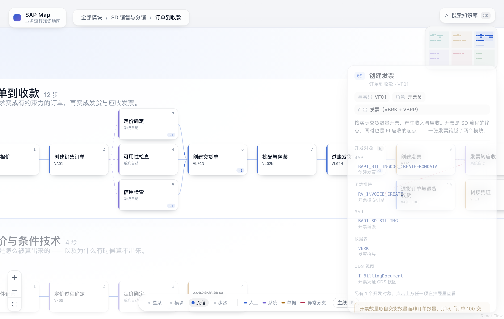
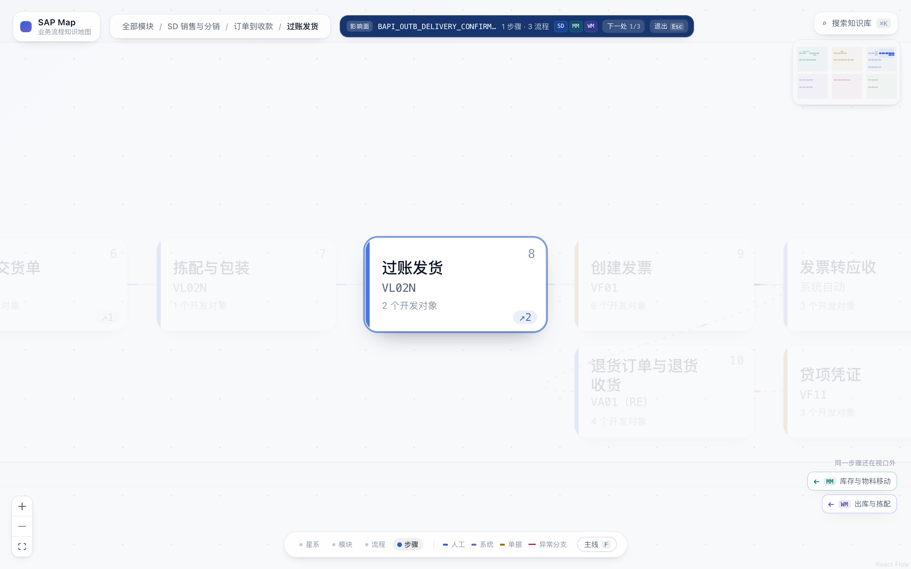
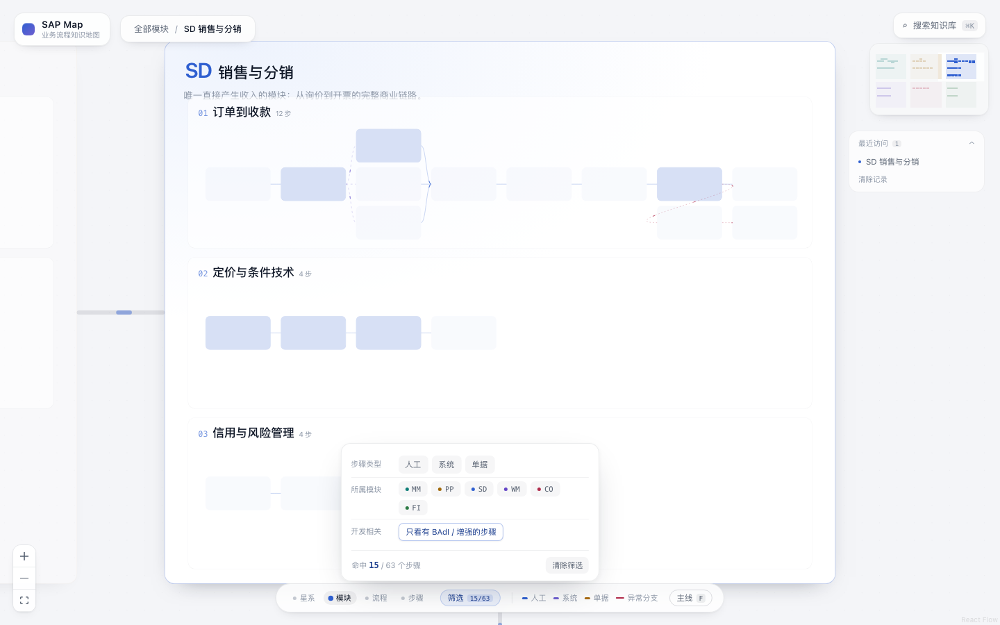
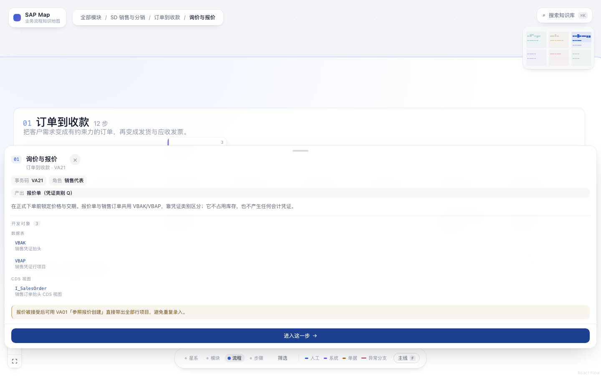

# 交互复盘与外部参考

> 写的日期：2026-11-25 · 对象：当前 M5 版本（12 流程 / 50 步骤 / 105 开发对象 / 19 段代码）
> 目的：先把"现在能怎么操作"讲清楚，再看同类产品里哪些交互值得借。

---

## 0. 一句话结论

现在的交互是**一条垂直阶梯 + 两条横向通道**：

- 垂直：`L0 星系 → L1 模块 → L2 流程 → L3 步骤`，靠缩放和点击下钻。
- 横向 1：**幽灵锚点**，回答"同一步骤还在哪些模块"。
- 横向 2：**主线轨道**，回答"这一步在价值链里排第几"。

纵向已经完整，横向只做到了「**看见**」，还没做到「**追问**」。

用户能看到「过账发货也在 MM」，但问不了三件事：

1. 这个 BAPI 还被哪些步骤用？（反查）
2. 我改这个增强，会影响哪些流程？（影响面）
3. 从销售订单到收款，中间到底怎么连？（任意两点路径）

这三件事才是知识库从"能读"变成"能用来做判断"的分水岭。下面的外部参考，主要也是围绕这三件事找的。

---

## 1. 当前交互清单

按"用户实际做的动作"分组，不按组件分组。

### 1.1 空间与层级（纵向阶梯）

| 入口 | 行为 | 状态变化 | 评价 |
|---|---|---|---|
| 点模块卡 | 飞到模块，缩放 **0.42** | `focusedModuleId` + hash `#/m/sd` | 手感好；0.42 落在 L1 区间中部，不会在动画里反复切层 |
| 点泳道头 / 泳道 | 整条流程入画，缩放 **0.64–0.94** 自适应 | `focusedProcessId` + `#/p/sd.o2c` | 「一次看全一条流程」是对的；但窄视口会被 min 0.64 卡住（见 §3.2） |
| 点步骤卡 | 飞到 **1.28**，选中该步 | `selectedStepId` + `#/s/...` | 进入 L3 后泳道文字隐藏，画面干净 |
| 面包屑（4 级） | 逐级回跳 | 同导航 | 唯一显式的"向上"路径 |
| 点品牌 | 回 L0，fit 全部 | 清焦点 | 也承担了"我迷路了"的兜底 |
| 滚轮 | 自由缩放 0.07–1.9 | LOD 由 `zoom` 派生（0.30 / 0.62 / 1.15） | 阈值集中在 `lod.config.ts`，单点可调 |
| 拖拽 | 平移 | — | 双击缩放已关闭，避免误触 |
| MiniMap | 可拖、可缩 | — | 172×104，信息量刚好；但没有"当前视口"以外的语义 |
| Controls | + / − / fit | — | 位置在左下，和 LOD 指示器不冲突（实测无重叠） |

**做得好的**：只有一条下钻路径，没有"另一种进入方式"造成的分叉；每次跳转都有明确的目标缩放，不依赖用户自己找位置。

**代价**：**没有"返回上一级"的显式按钮**，浏览器后退也失效（见 §3.3）。

### 1.2 悬停：产品最有辨识度的部分

| 项 | 现状 |
|---|---|
| 触发 | `mouseenter` 步骤卡，卡片出现在卡片右侧 `+16px` |
| 关闭 | `mouseleave` 后 **240ms**；移入卡片则取消 |
| 内容 | 序号 · 标题 · 流程/T-code · 角色 · 产出 · 业务意图 · 开发对象（按类型分组，最多 5 个）· 「另有 N 个」· 「这一步也出现在」· 备注 |
| 同时发生 | 同一步骤的其他实例 `is-linked` 高亮；非同流程 `is-soft` 降透明；视口内画幽灵虚线 |

**做得好的**：信息密度分层合理——卡片给"够用的判断依据"，抽屉给"完整参数与代码"。悬停不是装饰，是真的在回答问题。

**代价**：这是**开发对象的唯一入口**。键盘只能 `Enter` 进 L3，看不到对象；触屏没有 hover；而且卡片会覆盖源卡片（见 §3.1）。

### 1.3 开发对象：右抽屉

- 打开：悬停卡里点任意对象。
- 内容：类型徽标 → 技术名 → 标题 → 用途 → **引用统计 + 被引用于** → 关键参数 → 示例代码（自研 ABAP 高亮）→ 容易踩的坑 → 官方文档。
- 关闭：点遮罩 / 点 ✕ / `Esc`。
- 反查：每行「模块 + 流程 + 步骤」，点击直接跳回画布上的那一步；「在图上查看影响」进入影响面模式。

**还缺**：焦点陷阱与滚动锁（遮罩仍是 `div` 不是 `dialog`），触屏下的抽屉行为。

### 1.4 幽灵锚点：跨模块的"看见"

| 场景 | 表现 |
|---|---|
| 其他实例在视口内 | 虚线 + 圆形模块徽标，1.1s 流动 |
| 其他实例在视口外 | 右下角竖排 rail：`← MM 库存与物料移动`，点击飞过去 |
| 悬停卡底部 | 带模块前缀的 chip：`FI ↗ 应付与付款` |
| 约束 | 起点必须也在视口内，否则不画（避免从屏幕外拉斜线） |

**做得好的**：把"内容只有一份、位置有很多处"这件事变成可见的。

**代价**：只在悬停/选中时存在，**没有持久模式**；发起方只能是步骤，不能是对象。

### 1.5 检索：⌘K

- 三类实体混排：流程 / 步骤 / 对象；事务码命中 **+45 分**（`MIGO` 排第一）。
- 键盘：`↑↓` 选择、`↵` 打开、`Esc` 关闭；默认 14 条，有查询时 26 条。
- 结果直接落到对应层级（流程→L2、步骤→L3、对象→抽屉）。

**缺**：只能搜"东西"，不能搜"动作"（如"只看系统步骤"）；没有拼音/模糊/子序列匹配，打错一个字就空；没有"在图上定位"的预览。

### 1.6 主线：价值链上的位置

- 开关：`F` 或底部「主线」；两条线用 tab 切换（计划到收款 15 步 / 退货闭环 5 步）。
- 点 chip 或「上一步 / 下一步」→ 逐步走到 L3；当前 chip 高亮并自动滚进视野；头部给一句交接说明。

**缺**：不能"播放"；退货线是独立 tab，而不是主线上的一条分叉——这恰好丢掉了"主线会分叉"这个事实。

### 1.7 键盘与可达性

| 已有 | 缺失 |
|---|---|
| `⌘K` 搜索、`F` 主线、`Enter` 进步骤、`Esc` 逐级退出（抽屉 → 影响面 → 步骤 → 流程 → 模块 → 全局）、`I` 影响面、`Shift+1` 全局、`Shift+2` 回到当前层级 | `?` 快捷键帮助、方向键在相邻步骤间移动、焦点陷阱与 `aria-live` |

### 1.8 动效与状态

- 飞行动画 620–800ms，线性插值 `x/y/zoom`；有 `navUntil` 防止动画途中的 L0 误清焦点。
- 无 `prefers-reduced-motion` 分支；无触屏适配（`pointer: coarse` 没有单独样式）。

---

## 2. 换一个视角：用户来这儿想干六件事

| # | 任务 | 典型话 | 现在 | 说明 |
|---|---|---|---|---|
| T1 | **逛** | "SD 到底管什么？" | ✅ | 星系 + 主线足够建立第一印象 |
| T2 | **定位** | "MIGO 是哪一步？" | ✅ | ⌘K + 事务码加权，这是目前最顺的路径 |
| T3 | **理解** | "这一步为什么存在？" | ✅ | 悬停卡的"意图 + 产出 + 角色"三件套 |
| T4 | **串联** | "订单到收款中间经过谁？" | ⚠️ | 只有预设的两条主线；任意两点不行 |
| T5 | **影响** | "改这个 BAdI 会动到什么？" | ❌ | 完全缺失，数据层也没有反向索引 |
| T6 | **回访** | "上次看的那条流程在哪？" | ❌ | 没有历史、没有收藏、没有"最近" |

T1–T3 已经成立，T4 半成立。**T5 和 T6 是空白**，而这两个恰好是"顾问/开发真的会反复来"的理由。

---

## 3. 三个已经验证的问题（已修复）

### 3.1 悬停卡会盖住你正在悬停的卡片

`StepHoverCard` 固定出现在卡片右侧 `+16px`，然后 `left` 被 clamp 到 `innerWidth - W - 16`。当卡片靠右时，它会被推回左边，**直接压在源卡片上**。

实测（`sd.o2c` 最右侧的「发票转应收」）：

| 视口 | 源卡片 x 区间 | 悬停卡 x 区间 | 结果 |
|---|---|---|---|
| 1440×900 | 1226–1370 | 1068–1422 | 覆盖 |
| 1200×760 | 1106–1250 | 828–1182 | 覆盖 |

截图（1200×760）里「创建发票」整张卡被白卡盖住，只剩标题在缝隙里：



> **已修复**：先试右侧，放不下翻左侧，两侧都放不下才落到上/下方——任何情况下都不覆盖源卡片。
> 复测：1440 下最右卡片 1226–1370、浮层 856–1210，不重叠；中间卡片仍走右侧。

**为什么现在没炸**：卡片 `onMouseEnter` 会 `keepHover`，所以不会闪烁；但用户失去了"我在看哪一张"的空间锚点。**这是 hover 交互的硬伤，不是审美问题。**

修法（三选一）：
1. 空间不足时**翻到左侧**（`left = hover.x - W - 16`），并保证不覆盖源矩形；
2. 改成**跟随指针的浮动卡**，指针偏移 18px，永不相交；
3. 学 Signavio：**固定在右侧栏**，不浮动。信息量大的产品更适合这种"检查器"形态。

### 3.2 窄视口下流程取景会切掉泳道标题

`goProcess` 的缩放被夹在 `[0.64, 0.94]`（下限是为了不跌回 L1）。1200×760 时内容比视口宽，于是左右都溢出：

```
zoom = 0.64   lane-head.x = -66   → 「01 订单到收款」被切掉前两个字
```

**修法**：process 下限按可用宽度动态算（或降到 0.55），并给左右各留 24px；或者把泳道标题改成屏幕空间浮层——它本来就不是"图上的内容"，而是"这一层的标签"。

> **已修复**：缩放仍有下限（再小会跌回 L1），但取景改成「放得下就居中，放不下就左对齐 + 上留白」。
> 1200×760 复测：泳道标题 `x=46`，流程起点可见，剩余部分靠平移。

### 3.3 浏览器后退键会直接退出站点

`writeHash` 用的是 `history.replaceState`，所以每次下钻都不产生历史记录。按后退 = 回到进入本站之前的页面。

这在"分享深链给别人"的场景里尤其糟：对方点开 `#/s/sd.o2c/sd.o2c.goods-issue`，想退回流程层，只能找面包屑。

**修法**：层级导航（模块/流程/步骤）用 `pushState`；悬停、搜索高亮等瞬时状态不写历史；监听 `popstate` 走同一套 `goXxx`。注意别和 hash 的 `hashchange` 重复触发。

> **已修复**：导航动作默认 `push`，从 hash/popstate 恢复时传 `history: false`（用 `replace`）。
> 复测：`#/ → #/m/sd → #/p/sd.o2c`，两次后退依次回到模块（L1）与星系（L0）。
> `Esc` 逐级退出也走 `replace`，不会在历史里留下"退一级却多一条"。

---

## 4. 外部参考：值得借的九个机制

> 原则：只借"信息架构与交互机制"，不借视觉。我们的节点是"要读的卡片"，不是"数据点"。

### 4.1 SAP Signavio Process Explorer（2026.10 Relation Explorer）

**机制**：任意模型打开后，关系按类型分组列在侧栏；切到关系图可以 **hop by hop 向外走**，悬停任一条连线会显示"这条关系到底是什么"（feed / draw from）。

**借什么**：这正是"对象反查"的成熟形态。对象抽屉里加一个 **「关系」页**：
- 上游：哪些步骤 / 流程产出或引用它
- 下游：它写入哪些表、触发哪些后续步骤
- 每条关系可点，一层层走；悬停连线显示语义（"由 VA01 调用"）

**不要照搬**：它的关系图是独立画布。我们不应该再开一张图，而是在现有画布上"高亮 + 跳转"。

### 4.2 Neo4j Bloom

**机制**：右键 `Expand` 可按**关系类型和方向**展开；`Shortest Path` 找两点之间最短路径（20 跳内）；双击开 Inspector；`Select related nodes` / `Dismiss single nodes` 快速收窄场景；有 Presentation mode。

**借什么**：
- 步骤右键菜单：`只看相关`、`展开全部开发对象`、`隐藏其他流程`；
- 任意两点路径（T4 的完整解法）；
- 演示模式（隐藏 HUD，只留主线与画布）。

**不要照搬**：力导向布局。Bloom 每次展开都会重排，我们的空间记忆会崩。

### 4.3 Atlan / dbt Lineage

**机制**：基准资产左右各有 `+`，分别展开上游/下游；`View impact` 直接给受影响清单；深度可调；**Visibility slider** 把"不在路径上的资产"淡出；`refocus` 一键回到基准点。

**借什么**：**影响面模式**。选中一个开发对象后：
- 所有引用它的步骤高亮，其余降透明；
- 顶部给一句「3 个模块 · 7 个步骤 · 2 条主线」；
- 深度 1 / 2 切换（1 = 直接引用，2 = 引用它的步骤所在流程的其他步骤）。

这是把 T5 从 ❌ 变 ✅ 的最小实现，而且**不需要新数据**——`processesOfStep` 和 `step.objectIds` 已经能反推出反向索引。

### 4.4 Obsidian 局部关系图

**机制**：局部图只画当前笔记的邻域，**Depth 滑块 1/2/3**；全局图是"诊断工具"，局部图才是"日常视图"。

**借什么**：幽灵锚点现在是"同一步骤"（0 跳语义）。可以加一个**跳数**概念：
- 1 跳：同一步骤（现状）
- 2 跳：共享同一个开发对象的步骤（"这两步其实动的是同一张表"）

第 2 跳会暴露很多真实洞察，比如「创建销售订单」和「创建发票」共享 `VBRK` 的写入链。

**不要照搬**：全局图 + 力导向。我们的全局是刻意布局的星系。

### 4.5 TheBrain

**机制**：Plex 里每个节点有 `+/−` 就地展开/收起；`Mapped links` 把当前视图翻译成大纲（父/跳/子/兄弟）；`Backlinks` 显示"谁引用了我"；`Past thought list` 是访问历史；`Pins` 是收藏。

**借什么**：
- 侧栏「当前位置大纲」：模块 → 流程 → 步骤 → 兄弟步骤，可点；
- **最近访问**（8 条）+ **收藏**。T6 的最小解法，纯前端状态即可；
- 对象抽屉里的「被引用于」区块。

### 4.6 Concepts / thecatenary / Atta（无限画布三件套）

**机制**：
- 屏幕边缘出现**指向屏幕外内容的指针**，点一下跳过去；
- 视野里什么都没有时出现 **「Back to content」**；
- `Ctrl/Cmd+1` fit all、`Ctrl/Cmd+2` **fit selection**、`M` 切小地图、空格临时平移。

**借什么**：
- 我们已有右下角 rail，但只有"其他实例"，没有"我漂到空白处了"。加一个 **「回到内容」** 浮层（视野内无节点时出现）；
- `Shift+1` / `Shift+2`：fit 全局 / fit 当前流程。这是最高频的两个动作，现在只能靠滚轮找；
- 小地图在 <480px 隐藏（我们目前没隐藏，会挡内容）。

### 4.7 Van Wijk & Nuij（d3.interpolateZoom）

**机制**：缩放和平移不是两个动画，而是**一条等感知速度的路径**；画面在跨越距离时"先拉宽、到达时收窄"。

**为什么值得改**：我们现在的 `fly` 是 `x/y/zoom` 三个值各自线性插值。当起点和终点距离远、倍率差大时，观感是"**先缩放、再滑动**"——因为 zoom 是比值，线性插值会在前半段吃掉大部分放大倍数。

改动很小：`d3-interpolate` 的 `interpolateZoom` 约 40 行，可以照抄成 `lib/zoomPath.ts`，在 `fly` 里按 `t` 取 `(cx, cy, width)` 再换算 viewport。**这是投入产出比最高的一次手感升级。**

### 4.8 ScholarMate / ConceptScope（语义缩放的字）

**机制**：同一节点在不同缩放级别显示不同长度的文本（摘要 → 短句 → 原文）；ConceptScope 是"无标签 → 标签 → 标签 + 词云"。

**借什么**：我们的 L1 现在是"步骤压成细条、文字全部隐藏"，信息量为零。可以给每条加 **3–5 字微标签**（`建单` `审批` `过账` `开票`），让人在模块层就能读出流程形状，而不是一片彩色条。数据层加一个 `short` 字段即可。

### 4.9 SAP LeanIX（Fact Sheet + Inventory）

**机制**：同一个对象有两种入口——图画布（看关系）和**清单表**（看全量、排序、筛选）；点表里的行会在图上定位。

**借什么**：**清单视图**。105 个对象、50 个步骤，纯靠画布扫读效率不高。加一个可切换的表格视图（步骤 / 对象两个 tab，支持按模块、类型、是否有代码筛选），行 hover 时画布对应节点高亮。这是"老手"最高效的入口，也顺便解决"导出/对照"的需求。

**不要照搬**：不要把它做成另一个产品。表格只是画布的第二种读法，共用同一份 `data/`。

---

## 5. 建议：按"补哪个任务"排序

### P0 · 修三个已验证的问题（S）

| 项 | 做法 | 落点 |
|---|---|---|
| 悬停卡遮挡 | 空间不足翻左；或改成右侧固定检查器 | `panels/StepHoverCard.tsx` |
| 窄屏裁切 | process 缩放下限动态化 + 左右留白 | `canvas/hooks/useNavigate.ts` |
| 后退失效 | 层级导航 `pushState` + `popstate` | `lib/route.ts`、`useHashRoute` |

这三项不改信息架构，但直接决定"用起来是否可信"。

### P1 · 对象反查 + 影响面（M）——**如果只做一件事，做这个**

- 新增派生索引：`objectUsage: objectId → [{ stepId, processId, moduleId }]`（在 `data/index.ts` 里由现有数据算出，不新增内容）。
- 抽屉加「被引用于」区块，点条目跳回那一步（带 `goStep`）。
- 影响面模式：选中对象后，画布高亮引用它的步骤，其余降透明；顶部条显示「3 模块 · 7 步骤」；`Esc` 退出。
- 这一步同时补上 T5，并让"开发对象"从终点变成**图上的一个可追问的实体**。

### P2 · 导航补全（S–M）

- `Shift+1` fit 全局、`Shift+2` fit 当前流程、`Esc` 逐级退出（抽屉 → 步骤 → 流程 → 全局）。
- 视野为空时出现「回到内容」。
- 右下角 rail 增加"最近访问"区（本地存储，最多 8 条）。
- 触屏：点按 = 选中并显示卡片（不直接下钻），第二次点按才下钻；`pointer: coarse` 下卡片改为底部抽屉。

### P3 · 筛选与聚焦（M）

按 `kind`（人工/系统/单据）、`role`、是否有 BADI、所属模块筛选。视觉上不是"隐藏"，而是**降透明 + 计数**——保留空间记忆。参考 Atlan 的 visibility slider。

### P4 · 清单视图（M）

步骤 / 对象两个表，和画布双向联动。解决"扫读"和"对照"，不抢画布的主位。

### P5 · 主线升级（S–M）

- 「播放」：每 2.4s 走一步，可暂停；给客户讲流程时不用手点。
- 退货线做成主线的**分叉**而不是独立 tab（在「开票」节点分叉出去），这才是真实结构。

### P6 · 任意两点路径（M–L）

输入或选中两个步骤，BFS 出最短路径，画布上临时高亮那条链。数据上是 `step → process → step` 的二部图，20 行代码的 BFS；难的是**交互入口**（谁先谁后）。

### P7 · 对象作为节点（L）

L3 时把开发对象作为卫星节点铺在步骤周围，可点、可展开关系。这是最初设想的完整形态，但会显著增加画布密度，建议放在 P1/P3 之后再做。

---

## 6. 明确不建议学的

| 不学 | 原因 |
|---|---|
| 力导向 / 自动重排 | 每次布局抖动都会摧毁"空间记忆"，而这张图的价值一半在记忆 |
| AI 生成摘要替代原文 | 知识库的第一要求是**可核对**；摘要只能作为辅助层，且要标明是生成的 |
| 3D 透视 / 炫技转场 | 增加认知负荷，对"读文字"没有帮助 |
| 纯 hover 的信息架构 | 触屏、键盘、无障碍全部不可用；hover 只能是"加速器"，不能是"唯一门" |
| 无限层级嵌套 | 我们的领域只有 4 层（模块/流程/步骤/对象），再深就是过度设计 |

---

## 7. 一句话建议

**先修 P0（半天内可见），再做 P1（对象反查）。**

P0 决定"能不能信"，P1 决定"会不会再来"。
P2–P5 是舒适度与效率，等 P1 验证过"反查真的有人用"之后再排。

---

## 8. 已落地（2026-11-25）

### P0 · 三个问题的修复

| 问题 | 改法 | 落点 |
|---|---|---|
| 悬停卡遮挡源卡片 | 右侧 → 左侧 → 上/下三级避让，源卡矩形参与判断 | `panels/StepHoverCard.tsx`、`HoverInfo` 增加 `w/h` |
| 窄视口切掉泳道标题 | 「放得下居中、放不下左对齐」，纵向同理 | `canvas/hooks/useNavigate.ts` |
| 浏览器后退退出站点 | 层级导航 `pushState`，恢复视图 `replace`，`popstate` + `hashchange` 去重 | `lib/route.ts`、`app/hooks/useHashRoute.ts` |

顺手补的键盘约定：`Esc` 逐级退出、`Shift+1` 全局、`Shift+2` 回到当前层级。

### P1 · 对象反查与影响面

- **派生索引**：`usagesOfObject`（对象 → 步骤 × 流程 × 模块），由现有 `step.objectIds` 反算，**没有新增任何内容字段**。
- **抽屉**：显示「被 N 个步骤引用 · M 条流程 · K 个模块」，列出每个落位，点击跳转。
- **影响面模式**：画布只保留引用该对象的步骤（加强调环），其余压暗；顶栏常驻 chip 说明当前在看什么，`下一处` 在多个落位之间轮转。
- **入口兜底**：如果当前步骤并不用这个对象（例如从搜索直接打开），会先落到第一个引用它的步骤，避免"一屏全暗却没有高亮"。



**验证**：`npm run validate` 通过；生产构建 297ms / gzip 约 216 KB；`#/s/sd.o2c/sd.o2c.goods-issue` 深链正常；影响面在 SD → MM → WM 三处轮转；无 console 错误。

### 还没做

P4 清单视图、P5 主线播放、P6 两点路径、P7 对象卫星节点。

---

## 9. 第二轮落地（2026-11-25）

### P2 · 导航补全

| 能力 | 实现 | 为什么这样做 |
|---|---|---|
| 回到内容 | `MapCanvas` 在 `onMoveEnd` 用视口世界矩形与 6 个模块求交，全部不相交即 `offGrid`；`BackToContent` 给出方向箭头 + 目标名（`回到 SD 销售与分销 ↑`） | 无限画布最典型的失败态是「眼前一片空白」。只给按钮不够，还要告诉用户**内容在哪个方向** |
| 最近访问 | `lib/recent.ts` + `state.recent`，8 条，localStorage；模块/流程/步骤三类统一存 `key + 标题 + 强调色` | 网状图里人的记忆单位是「刚才那条流程」，不是「上一页」 |
| 触屏 | `matchMedia('(pointer: coarse)')` → `store.coarse`；第一次点按只选中并浮出**底部抽屉**，抽屉底部常驻「进入这一步 →」；点画布空白取消 | 原设计里「第二次点按下钻」被抽屉自身挡住了（实测点不到），所以把下钻做成显式按钮；`pointer` 媒体查询而不是 UA 嗅探，二合一设备翻转也能跟上 |
| 键盘 | 全站 `:focus-visible` 焦点环；步骤卡 `Tab` + `Enter`；`Esc` 链路保持 | 焦点可见是无障碍的底线，也是键盘用户唯一的「我在哪」 |




### P3 · 筛选与聚焦

- 三个维度：**步骤类型**（人工/系统/单据，多选）、**所属模块**（六选一）、**只看有 BAdI / 增强的步骤**。
- 视觉上是**压暗 + 计数**（命中 15 / 63 个步骤），不是隐藏：卡片位置不动，空间记忆不塌。
- 模块筛选同时压暗无关泳道与模块岛屿，保留「它们还在那儿」的轮廓。
- 弹层挂在 `body` 上（`createPortal`）并按触发按钮的实际矩形算位置：底栏有 `backdrop-filter`，`:fixed` 子元素会相对底栏定位，窄屏上会被挤扁。

**验证**：`npm run validate` 通过；构建 285ms；点 SD 模块 → `#/m/sd`；点步骤 → `#/s/<流程>/<步骤>`；`Shift+1` 回全局；浏览器后退不退出站点；触屏第一次点按出抽屉、`进入这一步` 落到 `#/s/sd.o2c/sd.o2c.inquiry`；筛选 15/63 命中、48 个步骤被压暗；平移出内容后出现「回到 SD 销售与分销 ←」，点击回到模块视图；820px / 390px 下底栏无横向溢出。

### 仍未做

P7 对象卫星节点。

---

## 10. 第三轮落地（P4–P6）

### P4 · 清单视图（`L`）

- 左栏 408px，两个页签：**步骤**（每个「流程 × 步骤」一行，共 63 行）/ **开发对象**（105 行）。
- 步骤表按模块分组、粘性表头；列是 类型条 / 名称 / 事务码 / 种类 / 对象数 / `↗n` 复用标记 / 所属流程（hover 才出现，点它只看那条流程）。
- **双向联动**：点行 → `goStep`；画布上选中某步 → 表自动滚到那一行并高亮（`scrollIntoView` + `is-on`）。
- 面板开合会改变可视区，所以 `useNavigate` 的 `measure()` 现在会减掉面板宽度并在取景时加回左边距——否则内容会藏在面板底下。
- 「跟随画布」默认开：聚焦某模块时只列该模块的步骤。

### P5 · 主线升级

- **播放**：每 2.4s 走一拍，走到最后一拍自动停，随时可暂停。定时器依赖 `activeIdx`，`beats` 用 `useMemo` 固定——否则任何无关重渲染都会把计时器重置。
- **分叉**：退货线在数据里标 `branch: { flowId, atStepId }`，渲染成主线下方一行「↳ 退货闭环 · 从『创建发票』分叉」，不再是需要用户自己发现的 tab。`validate` 会检查分叉点确实在父线上。

### P6 · 两点路径（`P`）

- 图模型：节点 = `流程 × 步骤` 实例；三类边——流程内流向、同一步骤的跨流程交接、**主线上相邻两拍**（跨流程不同步骤的业务交接，比如「MRP 运算 → 采购申请」）。
- BFS 求最少跳数；连续的同一步骤折叠成一个 chip 并标「经 n 次交接」，否则用户会以为中间还有一步。
- 入口：起点默认取**当前选中的步骤**（省掉「谁先谁后」的犹豫），只需搜终点；回车确定。无路可走时给「反过来试试」。
- 高亮：路径上的步骤全亮并加青色描边，其余压到 0.12；点 chip 可跳到那一拍。

**验证**：`validate` 通过并新增三条路径断言——`pp.mrp.demand → fi.ar.incoming-payment` 8 跳、`mm.p2p.po → sd.o2c.billing` 3 跳、`sd.o2c.billing → sd.o2c.credit-memo` 2 跳；`tsc` 通过；构建 303ms，gzip 约 222 KB。


## 11. 文本早显（2026-11-25）

问题：模块视图（zoom 0.42）里步骤只是一条条色块，名字要放大到 0.62 以后才出现，而且出来时字号只有 7~8px。

改法：

- **L1 就出名字**。模块视图是「这块区域有哪些活」的层级，正是需要名字的地方。
- **最小屏幕字号**：`--inv = 1/zoom` 写到画布容器，`font-size: max(19px, calc(11px * var(--inv)))`。低倍率反算放大世界字号，高倍率维持设计值；`--inv` 变化超过 4% 才写入，避免缩放时每帧重排。
- L1 标题锁 2 行 + 省略号（最低倍率下 3 行会溢出卡片）；L2 把辅助行的最小字号提到 9.5px。
- 满宽色条是绝对定位，会压住文字，L1 标题抬 `z-index: 1`。

验证：`tsc` / `build` 通过。**未做截图验收**（无头浏览器仍被环境拦截）。
